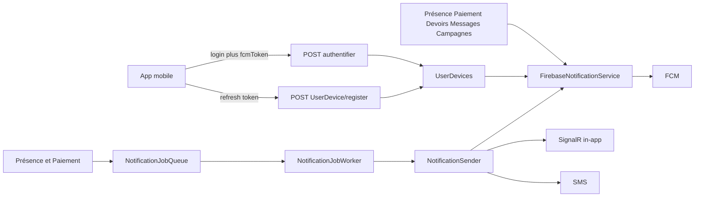
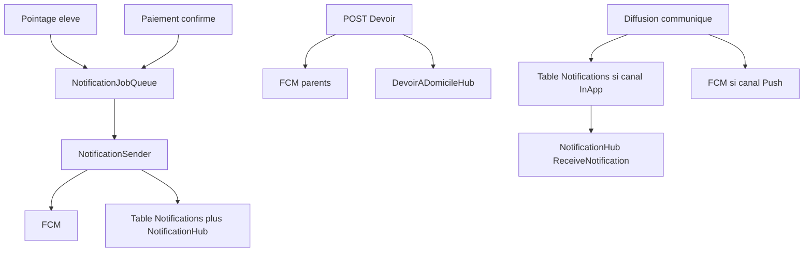

# État des notifications push (KelasiNaBisoAPI)

Inventaire **à jour** de ce qui est déjà en place pour FCM. Ce n’est **pas** un module unique : service FCM générique, pipeline asynchrone (présence / paiement), et envois directs (devoirs, messages, inscriptions, campagnes).

**Date :** 2026-10-06  
**Swagger :** `https://localhost:7102/swagger/index.html`  
**Guide d’intégration frontend (Vue 3 / Flutter) :** [`DOCUMENTATION_FRONTEND_NOTIFICATIONS.md`](DOCUMENTATION_FRONTEND_NOTIFICATIONS.md)  
**Guide mobile (archive, à recouper) :** [`docs/archive/md/GUIDE_INTEGRATION_FRONTEND_NOTIFICATIONS.md`](docs/archive/md/GUIDE_INTEGRATION_FRONTEND_NOTIFICATIONS.md)

---

## Vue d’ensemble

Les push **fonctionnent côté API** si Firebase est initialisé au démarrage et si l’utilisateur a au moins un `UserDevice` avec `statut = true` et un `fcmToken` valide.

---

## Socle technique

| Élément | Fichier / config |
|---------|------------------|
| Firebase Admin SDK | [`Services/FirebaseNotificationService.cs`](Services/FirebaseNotificationService.cs) |
| Init au boot | [`Program.cs`](Program.cs) — `Firebase:CredentialsPath` (JSON service account) |
| DI | `IFirebaseNotificationService` → `FirebaseNotificationService` (scoped) |
| Devices | Table `UserDevices` — [`Models/UserDevice.cs`](Models/UserDevice.cs) |
| Worker file | [`NotificationJobWorker`](Services/Notifications/NotificationJobWorker.cs) (`AddHostedService`) |

Champs device utiles : `fcmToken`, `deviceType` (`Android` / `iOS` / `Web`), modèle, OS, **`statut`** (actif), `appVersion`. Les tokens FCM en échec sont désactivés (`statut = false`) après multicast.

---

## Enregistrement et refresh du token FCM

| Action | Endpoint |
|--------|----------|
| Login | `POST /api/Utilisateur/authentifier` — body `fcmToken` + `deviceType` (ignorer `"string"` / `"null"`) |
| Refresh hors login | `POST /api/UserDevice/register` |
| Déconnexion | `POST /api/Utilisateur/deconnecter` — désactive / retire le device |

**Pas d’endpoint `refreshFCM`.** En `onTokenRefresh` Firebase : rappeler `UserDevice/register` (ou se reconnecter avec le nouveau token).

Hub SignalR in-app (web / app ouverte) : `/hubs/notifications`.

---

## Envoi manuel / broadcast

[`Controllers/NotificationPushController.cs`](Controllers/NotificationPushController.cs) — JWT requis (`[Authorize]`, **sans rôle fin**).

| Méthode | Route |
|---------|-------|
| POST | `/api/NotificationPush/utilisateur/{idUtilisateur}` |
| POST | `/api/NotificationPush/role/{idRole}` |
| POST | `/api/NotificationPush/ecole/{idEcole}` |
| POST | `/api/NotificationPush/classe/{idClasse}` |
| POST | `/api/NotificationPush/token` (image, sound, badge, clickAction) |

Body typique : `{ "titre", "corps", "donnees": { "type": "..." } }`.

---

## Canaux (ne pas confondre)

| Canal | Usage | Implémentation |
|-------|--------|----------------|
| **FCM push** | App en arrière-plan / écran verrouillé | `FirebaseNotificationService` |
| **In-app** | Centre de notifications + temps réel | Table `Notifications` + `NotificationHub` |
| **SMS** | Tuteur | `ISmsNotificationService` si `Ecole.AcceptNotification` |
| **Email** | Devoirs / campagnes | `IEmailService` (pas le pipeline présence) |

`AcceptNotification` sur l’école **n’est pas** un kill-switch FCM global : il gouverne surtout le SMS.

**In-App (centre de notifs)** = table `Notifications` + SignalR [`NotificationHub`](Hubs/NotificationHub.cs) (`/hubs/notifications`). Ce n’est **pas** le hub [`DevoirADomicileHub`](Hubs/DevoirADomicileHub.cs).

---

## Push et In-App automatiques : 4 flux

### Pointage de présence — Push et In-App (élève seulement)

Après `CreateAsync` si `IdEleve` est renseigné : [`PresenceService`](Services/PresenceService.cs) → `PreparePresenceAsync` → file → `NotificationSender`.

- **Push** : FCM vers le **compte Utilisateur du tuteur**.
- **In-App** : ligne `Notifications` + `NotificationHub`.
- SMS si `Ecole.AcceptNotification`.

Pas de notif parent pour un pointage **agent**. Ignoré si pas de tuteur, tuteur inactif, ou pas de compte utilisateur. Opt-out préférences `push` / `inapp`.

### Paiement — Push et In-App (élève, déjà confirmé)

Même pipeline (`PaiementEleve`) :

- `CreateAsync` / batch si élève **et** pas en attente gateway Moko.
- Après confirmation PayIn : `NotifierPaiementConfirmeAsync`.

Push + In-App vers le tuteur, mêmes conditions. Le SignalR **dashboard** est un canal admin, pas le centre In-App parent.

### Envoi de devoir — Push oui ; In-App centre non

À la **publication** (`POST`), fire-and-forget :

- **Push FCM** vers les parents de la classe + SMS + email.
- **SignalR** `DevoirADomicileHub` (toast si l’app est sur **ce** hub).

Aucune insertion dans `Notifications`, aucun appel à `NotificationHub`. Pas de push si le parent n’a pas de `UserDevice` actif.

### Communiqué — selon les canaux cochés

[`CommunicationDispatchWorker`](Services/CommunicationDispatchWorker.cs) n’envoie que les canaux du JSON campagne.

Défaut : **`push: true`, `inApp: true`**, email/sms false.

- **In-App** : insert `Notifications` (`TypeNotification = COMMUNICATION`) **et** SignalR `NotificationHub` (`ReceiveNotification` sur `user_{idUtilisateur}`). Ce n’est pas un canal à cocher : il suit **InApp**. Échec hub = log, campagne OK.
- **Push** : FCM si le canal Push est activé et token présent.

### Synthèse

| Événement | Push FCM auto | In-App (`Notifications` + hub notifs) |
|-----------|---------------|----------------------------------------|
| Pointage **élève** | Oui (tuteur avec compte + token) | Oui |
| Pointage **agent** | Non | Non |
| Paiement élève confirmé | Oui (idem tuteur) | Oui |
| Paiement en attente Moko | Non (après confirmation oui) | Non puis oui |
| Nouveau devoir | Oui (parents) | Non (seulement hub **devoirs**) |
| Communiqué diffusé | Oui si canal Push (défaut oui) | Oui si canal InApp (défaut oui) + SignalR notifs |

Pour aligner le devoir sur présence/paiement : persister une `Notification` et notifier `NotificationHub` (éventuellement via la file).

---

## Flux métier qui envoient déjà du push

### File d’attente (présence et paiement)

`NotificationKind` = `PresenceEleve` | `PaiementEleve` uniquement.

`PresenceService` / `PaiementService` → `INotificationDispatcher.Prepare*` → `INotificationJobQueue` → `NotificationJobWorker` → [`NotificationSender`](Services/Notifications/NotificationSender.cs) (Push + In-app/SignalR + SMS, opt-out).

Textes : [`PresenceNotificationBuilder`](Services/Notifications/PresenceNotificationBuilder.cs), [`PaiementNotificationBuilder`](Services/Notifications/PaiementNotificationBuilder.cs).

### Envois FCM directs (hors file)

| Métier | Où |
|--------|-----|
| Publication devoir (parents, fire-and-forget + nouveau scope) | [`DevoirADomicileController`](Controllers/DevoirADomicileController.cs) — aussi SignalR, SMS, email |
| Inscription / compte tuteur | [`TuteurCompteService`](Services/TuteurCompteService.cs), [`InscriptionService`](Services/InscriptionService.cs) |
| Messages / groupes | [`MessageService`](Services/MessageService.cs), [`GroupeMessageService`](Services/GroupeMessageService.cs) |
| Convocations / réunions / alertes | [`NotificationService`](Services/NotificationService.cs) — priorité HAUTE = push + SMS |
| Campagnes communication | [`CommunicationDispatchWorker`](Services/CommunicationDispatchWorker.cs) |
| Mise à jour app | [`AppUpdateService`](Services/AppUpdateService.cs) — `EnvoyerNotificationATokenAsync` |

---

## Contrat mobile (minimum)

1. Demander la permission FCM (iOS).
2. Obtenir le token, l’envoyer au **login** et à chaque **`onTokenRefresh`** via `POST /api/UserDevice/register`.
3. Gérer le message : `notification.title` / `body` + `data` (clés métier, ex. `type`).
4. Optionnel : se connecter à SignalR `/hubs/notifications` pour l’in-app quand l’app est ouverte.
5. Au logout : appeler `deconnecter` pour ne plus recevoir les push du compte.

Sans token enregistré, les logs API indiquent « Aucun token FCM actif » : ce n’est pas une panne Firebase, c’est un device manquant.

---

## Limites connues (non corrigées ici)

- **Multicast FCM 500 tokens** : un seul `MulticastMessage` pour école / rôle / classe — risque d’échec au-delà de 500 devices.
- **Deux architectures** : présence/paiement en file ; devoirs/messages/inscriptions en appel direct / `Task.Run` (moins de retry).
- **Pas de `refreshFCM` dédié.**
- **`NotificationPushController` et GET `UserDevice`** : tout JWT authentifié peut théoriquement broadcaster ou lister des devices.
- Beaucoup de notes dans `docs/archive/md/*NOTIFICATION*` (nov. 2025) sont **partiellement obsolètes** (ex. blocage `Statut` VARCHAR). **Ce fichier est la référence.**

---

## Code de référence

- [`Services/FirebaseNotificationService.cs`](Services/FirebaseNotificationService.cs)
- [`Controllers/NotificationPushController.cs`](Controllers/NotificationPushController.cs)
- [`Controllers/UserDeviceController.cs`](Controllers/UserDeviceController.cs)
- [`Services/Notifications/NotificationSender.cs`](Services/Notifications/NotificationSender.cs)
- [`Hubs/NotificationHub.cs`](Hubs/NotificationHub.cs)
