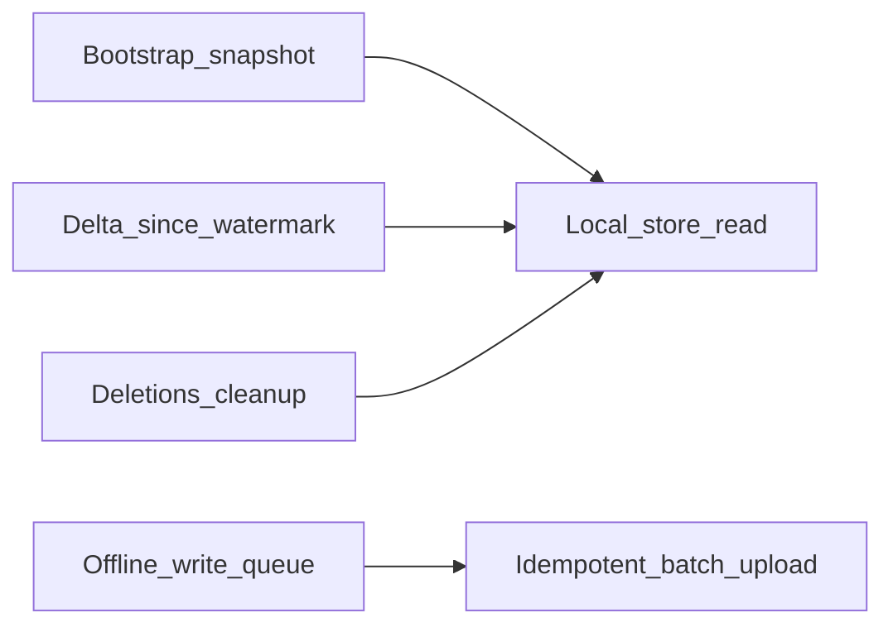

# Intégration portable — Mode Offline / Sync

Playbook **découplé du métier** pour reproduire un mode hors ligne dans un autre projet (lecture locale + file d’écritures idempotentes).

Ce document décrit des **patterns** et un **contrat HTTP générique**. Aucun domaine (école, énergie, commerce…) n’est requis pour le comprendre. Le mapping vers KelasiNaBiso est en **Annexe A**.

---

## Table des matières

1. [Objectif et non-objectifs](#1-objectif-et-non-objectifs)
2. [Architecture](#2-architecture)
3. [Vocabulaire abstrait](#3-vocabulaire-abstrait)
4. [Contrat HTTP générique](#4-contrat-http-générique)
5. [Batch d’écritures](#5-batch-décritures)
6. [Cycle client](#6-cycle-client)
7. [Erreurs et retry](#7-erreurs-et-retry)
8. [Checklist d’adaptation](#8-checklist-dadaptation)
9. [Annexe A — Mapping KelasiNaBiso](#annexe-a--mapping-kelasinabiso)
10. [Annexe B — Backend minimal](#annexe-b--backend-minimal)

---

## 1. Objectif et non-objectifs

### Objectif

Permettre à une app (mobile / web) de :

1. Télécharger un **jeu de données lecture seule** (fiches + éventuels soldes / postes).
2. Créer localement des **écritures** hors ligne (UUID stable).
3. Les **remonter** au serveur par batch sans double effet (idempotence).
4. **Purger** le cache local quand le serveur signale suppressions / désactivations.

### Non-objectifs

| Hors scope | Détail |
|------------|--------|
| Choix de store local | SQLite, Hive, Drift, IndexedDB… au choix du client |
| CRUD offline des fiches syncées | Les entités pullées restent **read-only** hors ligne |
| Sync temps réel / CRDT | Pas de sync bi-directionnelle concurrente sur les fiches |
| Flux réseau async | Paiement électronique, 3-D Secure, webhooks — **exclus** de la file |
| Snippets UI d’un produit | Voir le guide frontend du projet cible |

### Prérequis techniques

- Auth : `Authorization: Bearer {jwt}`
- JSON : **camelCase**
- Tenant (organisation) : **dérivé du JWT**, pas d’`idTenant` en query sur les routes sync

---

## 2. Architecture



| Pattern | Rôle |
|---------|------|
| **Bootstrap** | Snapshot initial + watermark pour démarrer |
| **Delta** | Modifications depuis `since` (watermark) |
| **Cursor** | Pagination opaque des gros volumes |
| **Snapshot** | Token de cohérence pendant une session de sync |
| **File d’écritures** | Créations locales hors ligne |
| **Batch idempotent** | Upload avec `clientRequestId` (UUID) unique |
| **Deletions** | Purge soft-delete / désactivations du cache local |

### Invariants (à conserver partout)

| Règle | Conséquence |
|-------|-------------|
| Fiches syncées = **read-only** offline | Pas de PUT/PATCH offline sur les entités pullées |
| Seule la file d’écritures est créée hors ligne | 1 à N types de batch possibles (même pattern) |
| Chaque écriture a un `clientRequestId` stable | Rejeu réseau sans double effet |
| Watermark persisté localement | Delta fiable au reconnect |
| Flux réseau temps réel exclus de la file | Ex. paiement électronique async |

---

## 3. Vocabulaire abstrait

| Concept | Signification | Exemple de remplacement |
|---------|---------------|-------------------------|
| **Tenant** | Périmètre d’isolation (JWT) | société, école, magasin |
| **Entity** | Fiche lecture seule pullée | client, élève, article |
| **BalanceItem** | Poste / solde lié à une Entity | arriéré, frais dû, commande ouverte |
| **WriteItem** | Écriture créée offline | paiement CASH, pointage, commande |
| **Watermark** | Curseur temporel opaque serveur | `since` / `nextSince` |
| **Cursor** | Token de pagination opaque | `cursor` / `nextCursor` |
| **Snapshot** | Cohérence de session de sync | query `snapshot` |
| **clientRequestId** | UUID ≤ 36 car. figé à la création locale | clé d’idempotence |

---

## 4. Contrat HTTP générique

Préfixe typique : `/api/sync`. Tous les endpoints : `[Authorize]`.

| Méthode | Route générique | Rôle |
|---------|-----------------|------|
| `GET` | `/api/sync/bootstrap` | Snapshot initial + watermark |
| `GET` | `/api/sync/{entities}` | Delta / pages fiches lecture |
| `GET` | `/api/sync/{balance-items}` | Delta / pages soldes (optionnel) |
| `GET` | `/api/sync/deletions` | Purge soft-delete / désactivations |
| `POST` | `/api/sync/{writes}/batch` | Upload écritures (répétable par type) |

`{entities}`, `{balance-items}`, `{writes}` sont des **placeholders** : chaque projet choisit ses chemins.

Limites de pagination recommandées : `pageSize` défaut `1000`, max `5000`.

### 4.1 Bootstrap

```http
GET /api/sync/bootstrap
```

Réponse (shape générique) :

```json
{
  "watermark": "opaque-server-watermark",
  "entities": [ /* EntitySyncDto */ ],
  "balanceItems": [ /* BalanceItemSyncDto — optionnel */ ]
}
```

Cas d’usage : première install, reset local, sync forcée après longue inactivité. Si le volume dépasse le plafond bootstrap, enchaîner les endpoints paginés.

### 4.2 Entities — page + delta

```http
GET /api/sync/{entities}?since={watermark}&cursor={cursor}&pageSize=1000&snapshot={snapshot}
```

Query : `since`, `cursor`, `pageSize`, `snapshot` — optionnels.

Réponse :

```json
{
  "snapshot": "…",
  "items": [
    {
      "idEntity": 1,
      "displayName": "…",
      "isActive": true,
      "updatedAt": "2024-03-21T10:30:00.000Z"
    }
  ],
  "nextCursor": "…",
  "hasMore": true,
  "nextSince": "opaque-server-watermark"
}
```

Les champs métier (`adresse`, `matricule`, …) sont **extensions** du projet cible : hors scope de ce playbook.

### 4.3 Balance items — page + delta (optionnel)

```http
GET /api/sync/{balance-items}?since={watermark}&cursor={cursor}&pageSize=1000&onlyOutstanding=true
```

Item type :

```json
{
  "idBalanceItem": 1,
  "idEntity": 1,
  "amountDue": 10000,
  "amountPaid": 5000,
  "amountTotal": 15000,
  "updatedAt": "2024-03-21T10:30:00.000Z"
}
```

Filtre `onlyOutstanding` (défaut souvent `true`) : ne renvoyer que les postes encore dus.

### 4.4 Deletions — purge cache

```http
GET /api/sync/deletions?since={watermark}&snapshot={snapshot}
```

`since` est **obligatoire**.

Réponse (listes d’IDs typées par collection) :

```json
{
  "snapshot": "…",
  "deletedEntityIds": [123],
  "deactivatedEntityIds": [45],
  "removedBalanceItemIds": [678],
  "deletedWriteIds": [],
  "nextSince": "opaque-server-watermark"
}
```

Actions locales :

- Retirer / désactiver les IDs de `deleted*` / `deactivated*`
- Retirer les postes de `removed*`
- Persister `nextSince`

### 4.5 Concepts techniques

**Watermark** — chaîne opaque fournie par le serveur. Persister après bootstrap et après chaque page / deletions réussie. Repasser en `since` pour le delta.

**Cursor** — token opaque. Boucler tant que `hasMore === true` en passant `nextCursor`.

**Snapshot** — token de cohérence de session. Conserver celui renvoyé dans la page courante pour les requêtes suivantes de la même session.

---

## 5. Batch d’écritures

Un projet peut exposer **N endpoints batch** (paiement, pointage, inventaire…) : **même contrat**.

```http
POST /api/sync/{writes}/batch
Content-Type: application/json
```

Corps — propriété **`items`** (pas le nom du métier) :

```json
{
  "items": [
    {
      "clientRequestId": "550e8400-e29b-41d4-a716-446655440000",
      "idEntity": 1,
      "/* champs métier WriteItem */": "…",
      "deviceId": "device-abc"
    }
  ]
}
```

| Champ | Obligatoire | Notes |
|-------|-------------|-------|
| `clientRequestId` | oui | UUID stable, max 36 |
| Champs métier | selon batch | montant, date, cible… |
| `deviceId` | non | Traçabilité appareil (body, pas header) |

Réponse :

```json
{
  "results": [
    {
      "clientRequestId": "550e8400-e29b-41d4-a716-446655440000",
      "status": "created",
      "resourceId": 456,
      "message": null,
      "errorCode": null
    }
  ],
  "summary": {
    "total": 1,
    "created": 1,
    "duplicates": 0,
    "rejected": 0,
    "errors": 0
  }
}
```

Le batch répond **HTTP 200** même si des items sont rejetés (traitement item-level).

| `status` | Action file locale |
|----------|-------------------|
| `created` | Succès — retirer de la file |
| `duplicate` | Déjà traité — retirer (idempotence OK) |
| `rejected` | Rejet métier — sortir de la file + UX (`errorCode` / `message`) |
| `error` | Erreur technique — **garder** et retry plus tard |

Ne jamais régénérer un `clientRequestId` pour la même écriture locale.

---

## 6. Cycle client

1. **Cold start** : `GET /bootstrap` → persister entities (+ balance items) + `watermark`
2. **Online périodique** : pages `{entities}` (+ `{balance-items}`) avec `since` / `cursor` → store → mémoriser `nextSince`
3. **Purge** : `GET /deletions?since=…` → appliquer les listes d’IDs
4. **Offline** : créer des WriteItems en file locale avec UUID figé à la création
5. **Reconnect** : `POST /{writes}/batch` (pour chaque type de file) → traiter chaque `status`
6. **Après upload** : re-sync balance items (et éventuellement entities) pour rafraîchir les soldes

Responsabilités client (sans imposer une techno de store) :

- Store local des fiches (+ soldes)
- File(s) d’écritures persistante(s) (survit au kill app)
- Indicateur online/offline + déclencheur de sync
- UUID stable dès la création locale

---

## 7. Erreurs et retry

| HTTP / cas | Cause | UI / client |
|------------|-------|-------------|
| 401 | JWT absent / expiré | Re-login avant sync |
| 400 | Tenant manquant / `since` absent sur deletions / body invalide | Corriger la requête |
| 500 | Erreur serveur | Retry avec backoff ; ne pas vider la file |
| Batch `rejected` | Validation métier | Afficher `message` / `errorCode` ; ne pas boucler à l’infini |
| Batch `duplicate` | Rejeu du même UUID | Traiter comme succès idempotent |
| `deletions` sans `since` | Paramètre requis | Toujours envoyer le watermark local |
| Double écriture sans UUID stable | Bug client | Garantir UUID à la création locale |

Corps d’erreur serveur typique : `{ "message": "…" }`.

---

## 8. Checklist d’adaptation

À remplir **dans le projet cible** avant d’implémenter.

| Décision | Votre choix |
|----------|-------------|
| Claim JWT du tenant | ex. `idSociete`, `idEcole`, `idStore` |
| Collection(s) Entity (pull) | 1–N routes `/api/sync/...` |
| Collection(s) BalanceItem | 0–N (optionnel) |
| Type(s) de WriteItem / batch | 1–N ; mêmes `status` partout |
| Limite items / batch | ex. 100, 200 |
| Source des deletions | AuditLogs, soft-statut, table `DeletedAt`… |
| Codes `errorCode` métier | liste figée documentée côté API |
| Flux exclus de la file | paiements réseau, signatures, etc. |
| Store local client | au choix |
| Permissions sur les batches | ex. `Xxx.Create` |

### Checklist d’intégration

- [ ] JWT sur toutes les routes `/api/sync/*`
- [ ] Bootstrap au premier lancement ; watermark persisté
- [ ] Delta via `since` + pagination via `cursor` / `hasMore`
- [ ] Fiches = lecture seule offline
- [ ] File(s) d’écritures avec `clientRequestId` UUID unique et stable
- [ ] Upload via `{ items: [...] }`
- [ ] Traitement des 4 `status` : `created` / `duplicate` / `rejected` / `error`
- [ ] Purge via `deletions`
- [ ] Flux réseau temps réel **exclus** de la file offline
- [ ] Re-sync soldes après batch réussi (si applicable)
- [ ] États UI : loading / empty / error / « en attente de sync »

---

## Annexe A — Mapping KelasiNaBiso

Référence produit (non portable). Détail frontend : [DOCUMENTATION_INTEGRATION_FRONTEND_OFFLINE_SYNC_VUE_FLUTTER.md](DOCUMENTATION_INTEGRATION_FRONTEND_OFFLINE_SYNC_VUE_FLUTTER.md).

| Concept portable | KelasiNaBiso |
|------------------|--------------|
| Tenant (JWT) | `IdEcole` / `idEcole` |
| Entity | `GET /api/sync/eleves` (alias `/clients`) |
| BalanceItem | `GET /api/sync/frais-dus` (alias `/arrears`) |
| WriteItem (paiement) | `POST /api/sync/payments/batch` — CASH-like uniquement |
| WriteItem (présence) | `POST /api/sync/presences/batch` |
| Deletions | `GET /api/sync/deletions` |
| Journal d’idempotence | table `SyncClientRequests` |

Règles produit :

- Élèves / frais dus : **read-only** offline
- Paiements réseau (ex. Moko) : **exclus** de la file
- Création : une année scolaire courante scope les pulls

---

## Annexe B — Backend minimal

À reproduire dans tout projet qui adopte ce pattern (indépendamment du langage).

### Table d’idempotence

Unicité : `(TenantId, ClientRequestId)`.

| Colonne | Rôle |
|---------|------|
| `TenantId` | Isolation multi-tenant |
| `ClientRequestId` | UUID client ≤ 36 |
| `ResourceType` | Type de WriteItem (`payment`, `presence`, …) |
| `ResourceId` | ID serveur si `created` |
| `Status` | `created` \| `duplicate` \| `rejected` \| `error` |
| `Message` / `ErrorCode` | Rejeu / UX |
| `ResultJson` | Payload pour rejouer un `duplicate` |
| `DeviceId` | Optionnel |
| `DateCreation` | Audit |

### Services (rôles)

| Service | Responsabilité |
|---------|----------------|
| **Pull** | Bootstrap + pages Entity (+ BalanceItem) + watermark / cursor / snapshot |
| **Idempotency** | Register / lookup `clientRequestId` ; renvoyer `duplicate` avec résultat stocké |
| **Batch** (× N) | Valider métier, créer ressource, journaliser statut item-level |
| **Deletions** | Agréger IDs soft-deleted / désactivés depuis `since` |

### Transfert depuis une implémentation existante

1. Copier le **contrat** (sections 2–7), pas les DTOs métier.
2. Remplacer Entity / BalanceItem / WriteItem par le domaine cible.
3. Garder la table d’idempotence et la matrice des `status`.
4. Documenter les `errorCode` et les flux exclus de la file.
5. Écrire le guide frontend **du produit** à part (ce playbook reste générique).
