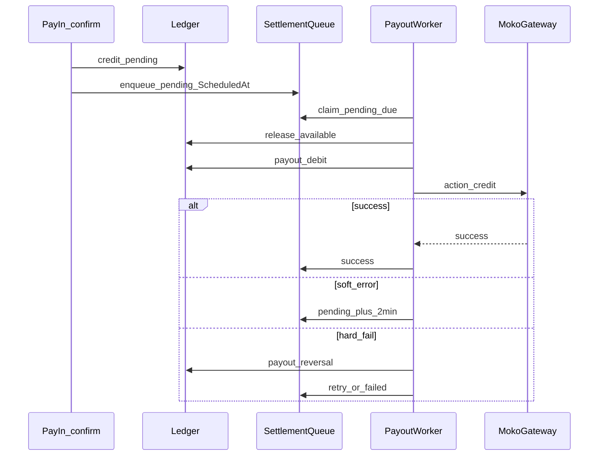

# Intégration portable du paiement électronique MokoAfrika

Ce document décrit une intégration **réutilisable** de MokoAfrika (GoFreshPay /
PayDRC) dans une API ou une application qui peut avoir des règles métier
différentes. Il sépare :

- le contrat technique MokoAfrika, qui doit rester stable ;
- l'orchestration de paiement, commune à la plupart des projets ;
- le **PayOut** (file de règlement + worker + ledger) — pattern à recopier tel
  quel, indépendamment du métier ;
- les règles métier de l'application hôte, à brancher via un adaptateur
  (annexe Kelasi).

Les exemples utilisent des valeurs fictives. Les clés, numéros et URL de
production doivent être fournis par MokoAfrika et stockés dans un gestionnaire
de secrets.

Référence gateway brut (payloads) : [`../integration-moko-afrika-projet-tiers.md`](../integration-moko-afrika-projet-tiers.md).

## 1. Périmètre et vocabulaire

| Terme | Signification |
|---|---|
| **PayIn** | Encaissement : le client paie le marchand (`debit`) |
| **PayOut** | Reversement : le marchand paie un bénéficiaire (`credit`) |
| **Gateway** | API HTTP MokoAfrika |
| **Référence** | Identifiant unique généré par l'application pour une transaction |
| **Callback** | Webhook envoyé par MokoAfrika après une évolution de statut |
| **Transaction locale** | Trace immuable des appels, réponses et changements de statut |
| **Règle métier** | Validation propre au projet : commande, facture, abonnement, frais, etc. |

Une transaction MokoAfrika ne doit pas être confondue avec l'objet métier payé.
Par exemple, une commande peut avoir plusieurs tentatives de paiement, et une
tentative ne doit être considérée comme payée qu'après confirmation définitive.

## 2. Architecture recommandée

```text
Client
  │
  ▼
API de paiement ──► Validateur métier / adaptateur du projet
  │                         │
  │                         └── autorise montant, devise, objet et payeur
  ▼
Orchestrateur de paiement
  ├── Transaction locale (audit + idempotence)
  ├── Client HTTP MokoAfrika
  ├── Traitement callback HMAC
  └── Worker de vérification / PayOut
             │
             ▼
       MokoAfrika Gateway
```

La couche gateway ne doit pas connaître les règles du domaine. Elle reçoit un
payload normalisé et retourne une réponse normalisée. L'orchestrateur décide
ensuite si la commande, la facture ou tout autre objet peut passer à l'état
`paid`.

### 2.1 Composants à implémenter

1. **Configuration** : identifiants marchand, URLs, secrets et callback.
2. **Client gateway** : POST JSON, timeout, journalisation sans secrets.
3. **Calculateur de frais** : montant net, frais de collecte et montant envoyé.
4. **Transaction repository** : persistance avant l'appel externe.
5. **Orchestrateur PayIn** : validation, création, appel, confirmation.
6. **Handler webhook** : signature, parsing, idempotence et routage.
7. **Job de réconciliation** : interrogation périodique des transactions
   PayIn toujours en attente.
8. **SettlementQueue + PayOut worker** (facultatif mais recommandé si
   reversement) : enqueue après PayIn `success`, poll, `credit`, retries — voir
   §10 (ce n’est pas un `POST /payout` synchrone).

## 3. Configuration

Exemple adaptable à `appsettings.json`, `.env` ou un secret manager :

```json
{
  "MokoAfrika": {
    "MerchantId": "VOTRE_MERCHANT_ID",
    "MerchantCode": "VOTRE_MERCHANT_CODE",
    "SecretKey": "VOTRE_SECRET_KEY",
    "HmacKey": "VOTRE_CLE_HMAC",
    "TestUrl": "https://api.gofreshpay.com/api/v1/gateway",
    "ProductionUrl": "https://paydrc.gofreshbakery.net/api/v5/",
    "IsProduction": false,
    "CallbackUrl": "https://api.example.com/api/payments/moko/callback",
    "StaticCustomerFirstName": "BUSINESS",
    "StaticCustomerLastName": "MERCHANT",
    "StaticCustomerEmail": "payments@example.com",
    "TimeoutSeconds": 120,
    "PayoutSettlementDelayMinutes": 3,
    "PayInUssdWindowSeconds": 120
  }
}
```

| Paramètre | Règle |
|---|---|
| `MerchantId`, `MerchantCode`, `SecretKey` | Identiques pour PayIn et PayOut |
| `HmacKey` | Secret utilisé pour vérifier le callback |
| `IsProduction` | Sélectionne l'URL de test ou de production |
| `CallbackUrl` | HTTPS public, accessible par MokoAfrika |
| `StaticCustomer*` | Profil marchand envoyé dans les requêtes ; `StaticCustomerEmail` sert aussi d’alerte ops PayOut |
| `TimeoutSeconds` | Ne pas confondre timeout HTTP et statut métier |
| `PayoutSettlementDelayMinutes` | Délai par défaut avant premier essai de PayOut (fallback si le tenant n’a pas sa propre valeur) |
| `PayInUssdWindowSeconds` | Fenêtre pendant laquelle un `Error` ambigu PayIn ne doit pas tuer un `pending` |

Ne jamais exposer `SecretKey` ou `HmacKey` au frontend, dans les logs, dans
Swagger public ou dans le contrôle de version. Le callback doit être configuré
avec la même URL pour les PayIn et les PayOut, sauf indication contraire de
MokoAfrika.

## 4. Contrat HTTP MokoAfrika

### 4.1 Requête commune

Toutes les opérations sont des `POST` avec `Content-Type: application/json`.

```http
POST https://api.gofreshpay.com/api/v1/gateway
Content-Type: application/json
```

Le champ `merchant_secrete` est volontairement écrit ainsi dans le contrat
gateway ; ne pas le renommer en `merchant_secret`.

```json
{
  "merchant_id": "merchant-id",
  "merchant_secrete": "secret",
  "merchant_code": "merchant-code",
  "amount": "1050.00",
  "currency": "CDF",
  "action": "debit",
  "customer_number": "0812345678",
  "firstname": "BUSINESS",
  "lastname": "MERCHANT",
  "e-mail": "payments@example.com",
  "reference": "MKO_20260925_000001",
  "method": "airtel",
  "callback_url": "https://api.example.com/api/payments/moko/callback"
}
```

Le nom du champ email est **`e-mail`**, avec un tiret.

### 4.2 Actions

| Action | Usage | `customer_number` |
|---|---|---|
| `debit` | PayIn client → marchand | Téléphone du payeur |
| `credit` | PayOut marchand → bénéficiaire | Téléphone du bénéficiaire |
| `verify` | Vérification du statut | Référence de la transaction |

Le même marchand peut donc collecter un paiement sur le numéro du client puis
effectuer un reversement sur un autre numéro, sans changer les identifiants
marchand.

### 4.3 Méthodes et devises

Les méthodes généralement prises en charge par l'intégration sont :
`airtel`, `orange`, `mpesa`, `africell` et `card`. La devise doit être
explicitement transmise, par exemple `CDF`. La liste réellement autorisée,
les plafonds et les frais doivent être confirmés avec MokoAfrika.

## 5. Références et modèle de données portable

Générer une référence unique, non réutilisable et indexée en base :

```text
MKO_{UTC_yyyyMMddHHmmss}_{identifiant-aléatoire}
```

Pour un PayOut, générer une nouvelle référence et conserver le lien vers le
PayIn parent (`parentReference`). Ne jamais utiliser la référence métier seule
si elle peut avoir plusieurs tentatives.

### 5.1 Transaction gateway minimale

```text
PaymentTransaction
  id
  reference                unique
  parentReference          nullable (PayOut)
  businessObjectType       ex. Order, Invoice, Subscription
  businessObjectId         identifiant dans l'application hôte
  action                   debit | credit | verify
  amount                   montant envoyé à MokoAfrika
  amountNet                montant métier avant frais
  collectionFee            frais PayIn
  payoutFee                frais PayOut estimés
  currency
  method
  customerPhone
  status                   pending | success | error | timeout
  gatewayTransactionId
  statusDescription
  rawRequest / rawResponse / rawCallback
  createdAt / updatedAt
```

Conserver les corps bruts pour le diagnostic, avec une politique de rétention
et une protection des données adaptée. Masquer les numéros et ne jamais
persister les secrets marchand dans ces champs.

### 5.2 États de l'objet métier

L'objet payé doit avoir ses propres états, par exemple :

```text
unpaid → payment_pending → paid
                     └──► payment_failed
```

Un `pending` gateway ne doit jamais produire `paid`. Le mapping entre statut
gateway et statut métier doit être centralisé dans l'orchestrateur.

## 6. Flux PayIn recommandé

1. Recevoir `businessObjectId`, montant net, devise, méthode et téléphone.
2. Charger l'objet métier avec verrou ou contrôle de concurrence.
3. Vérifier qu'il est payable et que le montant demandé est autorisé.
4. Vérifier l'absence d'une tentative `pending` équivalente.
5. Calculer les frais et le montant total à collecter.
6. Créer la transaction locale en `pending` **avant** l'appel gateway.
7. Appeler MokoAfrika avec `action: "debit"`.
8. Retourner la référence et `pending` au client.
9. Confirmer uniquement par callback ou par `verify`.
10. Dans une transaction DB idempotente, marquer l'objet payé et déclencher
    les effets annexes (reçu, notification, stock, accès, etc.).

L'appel initial peut répondre `resultCode: "0"` alors que le client doit encore
valider un USSD. Ce code signifie que la demande est acceptée, pas que l'argent
est définitivement reçu.

### Exemple de réponse API applicative

```json
{
  "reference": "MKO_20260925_000001",
  "status": "pending",
  "amountNet": 1000,
  "amountToCollect": 1050,
  "currency": "CDF",
  "method": "airtel",
  "requiresCustomerConfirmation": true
}
```

L'API hôte peut appeler ce endpoint `POST /api/payments/moko/payin`, mais le
nom et les paramètres doivent être adaptés au domaine cible. Il est préférable
de recevoir un `businessObjectType` + `businessObjectId` génériques ou un DTO
spécifique au projet, plutôt que de réutiliser des champs scolaires.

## 7. Frais et montant collecté

Conserver séparément :

```text
montantNet       = montant dû par le métier
fraisCollecte   = frais liés à l'encaissement
fraisPayout     = frais prévus pour le reversement
montantCollecte = montantNet + fraisCollecte + fraisPayout
```

Arrondir selon la règle contractuelle, généralement à deux décimales avec un
arrondi explicite. Ne pas recalculer les frais lors d'une confirmation :
persister le devis appliqué au moment de l'initiation.

Les taux varient selon l'opérateur et peuvent évoluer. Ils doivent être
configurables et validés côté serveur, jamais fournis uniquement par le
frontend. Exemple de contrat de calcul :

```json
{
  "amountNet": 1000,
  "collectionFee": 30,
  "payoutFee": 25,
  "amountToCollect": 1055,
  "currency": "CDF",
  "method": "airtel"
}
```

## 8. Callback (webhook)

Exposer une route publique dédiée, par exemple :

```http
POST /api/payments/moko/callback
X-Signature: sha256=<signature>
Content-Type: application/json
```

Le corps exact reçu doit être lu **sans le re-sérialiser** avant le calcul HMAC.
Calculer :

```text
signature = HMAC-SHA256(HmacKey, rawBody)
```

Accepter selon la convention contractuelle les formats hexadécimal ou Base64
et, si prévu par le fournisseur, le préfixe `sha256=`. Comparer en temps
constant. En cas de clé HMAC configurée et de signature absente ou invalide,
répondre `401` sans traiter le callback.

### Traitement idempotent

Le callback peut être livré plusieurs fois ou arriver après un `verify` :

- retrouver la transaction par `reference` ;
- ignorer sans erreur une référence inconnue après journalisation ;
- si déjà `success` et effets métier appliqués, répondre positivement sans
  rejouer ces effets ;
- si `success` mais confirmation locale incomplète, reprendre la confirmation ;
- enregistrer le dernier callback et sa date.

Répondre rapidement en `200` après avoir persisté le résultat. Si le traitement
long doit être asynchrone, placer un événement signé dans une file durable.

## 9. Statuts et interprétation

### 9.1 Statuts normalisés

| Statut local | Signification | Effet |
|---|---|---|
| `pending` | USSD ou traitement en cours | Aucun effet final |
| `success` | Confirmation définitive | Appliquer les effets métier une fois |
| `error` | Refus ou échec définitif | Marquer la tentative échouée |
| `timeout` | Aucune confirmation après politique de délai | Réconciliation ou échec selon le métier |

Normaliser les variantes MokoAfrika (`Success`, `successful`, `approved`,
`paid`, `completed`) vers `success`. Normaliser `pending`, `initiated`,
`processing` et `in_progress` vers `pending`.

Un champ `Status: Error` reçu immédiatement peut être ambigu pendant l'USSD.
Ne le transformer en échec définitif que si la réponse contient un signal
terminal explicite ou si la fenêtre de grâce est dépassée. Cette fenêtre doit
être configurable (par exemple 120 secondes).

### 9.2 Endpoint de vérification

Prévoir une route protégée telle que :

```http
POST /api/payments/moko/{reference}/check
```

Elle envoie à MokoAfrika :

```json
{
  "merchant_id": "merchant-id",
  "merchant_secrete": "secret",
  "merchant_code": "merchant-code",
  "action": "verify",
  "reference": "MKO_20260925_000001"
}
```

Le polling frontend doit être limité (intervalle, durée maximale et arrêt sur
`success`, `error` ou `timeout`). Un worker backend doit réconcilier les
transactions abandonnées, car le frontend peut être fermé.

## 10. PayOut — pattern file + worker + ledger

Le PayOut n’est **pas** un simple `POST credit` synchrone déclenché par le
frontend. L’implémentation de référence (et le pattern à recopier) est une
**orchestration locale** :

1. PayIn confirmé (`debit` → `success`) ;
2. crédit ledger en **pending** ;
3. enqueue dans une **file de règlement** (`SettlementQueue`) avec `ScheduledAt` ;
4. **worker** qui poll la file et exécute `action: credit` ;
5. retries / recrédit selon soft vs hard failure ;
6. callback `credit` qui met à jour la même machine d’états.

Sans PayOut (collecte seule), désactiver l’enqueue (`autoPayout = false`) et
ignorer ce chapitre.

Vocabulaire abstrait :

| Terme | Rôle |
|---|---|
| **Tenant** | Organisation isolée (magasin, école, société) |
| **Beneficiary** | Numéro Mobile Money du destinataire du `credit` |
| **SettlementQueue** | File durable des reversements à exécuter |
| **Ledger** | Soldes `pending` / `available` + mouvements auditables |

### 10.1 Séquence



### 10.2 Enqueue après confirmation PayIn

Déclencher **uniquement** quand le PayIn local passe à `success` (callback ou
`verify`), dans la même transaction DB que la confirmation métier :

| Condition | Action |
|---|---|
| `autoPayout == true` | Insérer une ligne file `pending` |
| `autoPayout == false` | Ne rien enqueue ; le solde reste gérable manuellement |
| Délai | `ScheduledAt = now + settlementDelayMinutes` (tenant ou config globale, défaut **3** min) |

Champs recommandés de la file :

```text
SettlementQueueItem
  id
  payInReference           lien vers le debit parent
  tenantId
  businessPaymentId        optionnel (facture / paiement local)
  amountNet                montant à reverser (devise ledger)
  currency
  method                   opérateur (airtel, orange, …)
  beneficiaryPhone         snapshot ou résolu à l’exécution
  scheduledAt
  payOutReference          nullable jusqu’à l’essai
  status                   pending | processing | success | failed
  retryCount
  errorMessage
  createdAt / updatedAt / processedAt
```

Index utiles : `(status, scheduledAt)`, `payInReference`.

### 10.3 Machine d’états de la file

```text
pending ──► processing ──► success
    ▲            │
    │            ├── soft failure ──► pending (ScheduledAt += 2 min)
    │            └── hard failure ──► pending (backoff) ou failed
    └────────────────────────────────┘
```

| Statut | Signification |
|---|---|
| `pending` | Éligible au worker quand `ScheduledAt <= now` |
| `processing` | Essai en cours (ne pas reprendre) |
| `success` | `credit` gateway réussi |
| `failed` | Échecs épuisés (`retryCount >= maxRetries`) |
| `cancelled` | Réservé ; **non branché** dans l’implémentation de référence |

### 10.4 Worker

Background service (ou job schedulé) :

| Paramètre de référence | Valeur |
|---|---|
| Intervalle de poll | **30 s** |
| Batch | jusqu’à **10** lignes `pending` avec `ScheduledAt <= now`, tri `ScheduledAt` |
| Exécution | une ligne à la fois ; erreur d’une ligne ≠ arrêt du batch |

**Multi-instances** : le worker de référence **n’a pas de lock distribué**.
Deux instances peuvent revendiquer la même ligne. Pour la prod multi-nœuds :
verrou DB (`SELECT … FOR UPDATE SKIP LOCKED`), lease, ou une seule instance
autorisée à tourner le worker.

### 10.5 Exécution d’une ligne (`ExecuterPayOut`)

Ordre recommandé (atomique autant que possible) :

1. Guard : ignorer si déjà `success` ou déjà `processing`.
2. Passer en `processing`.
3. Ledger : **release** `pending` → `available` (si pas déjà fait).
4. Résoudre le **Beneficiary** actif pour la méthode.
5. Générer une **nouvelle** référence PayOut (`MKO_…`) ; lier `parentReference = payInReference`.
6. Créer la transaction locale `action=credit` en `pending`.
7. Ledger : **`PAYOUT_DEBIT`** (débiter le disponible).
8. Appeler le gateway `action: "credit"` avec `customer_number` = bénéficiaire.
9. Interpréter la réponse :

| Cas | Effet file | Effet ledger | Effet tx credit |
|---|---|---|---|
| Gateway `IsSuccess` | `success` | inchangé (déjà débité) | `success` |
| Soft error (HTTP OK mais pas succès métier) | remettre `pending`, `ScheduledAt += 2 min` | inchangé ou selon politique | rester `pending` |
| Hard fail (HTTP ≥ 400 ou exception) | voir retries | **`PAYOUT_REVERSAL`** (recrédit) | `error` |

Réinitialiser `payOutReference = null` avant un nouvel essai hard pour forcer
une nouvelle référence gateway.

### 10.6 Retries et alertes

| Règle | Valeur de référence |
|---|---|
| Max retries | **5** |
| Backoff hard | `ScheduledAt = now + (5 × retryCount)` minutes |
| Soft | +**2** minutes, sans forcément incrémenter comme un hard fail |
| Alerte | email vers `StaticCustomerEmail` (ou canal ops) sur échec terminal / exception |

Le **callback `credit`** doit appliquer la **même** logique (succès → file
`success` ; échec → recrédit + retry ou `failed`). Ne pas traiter un callback
`credit` comme un PayIn.

### 10.7 Ledger (mouvements)

Ordre métier après un PayIn réussi avec PayOut auto :

```text
PAYIN_CREDIT_PENDING
  → (à l’exécution PayOut) PAYIN_RELEASE_AVAILABLE
  → PAYOUT_DEBIT
  → (si échec hard) PAYOUT_REVERSAL
```

Ne jamais se contenter d’un champ `balance` unique : sans `pending` /
`available`, un PayOut trop tôt ou un double débit devient indébuggable.

### 10.8 Retry manuel (ops)

Endpoint optionnel, réservé aux admins :

```http
POST /api/payments/moko/payout/retry?payInReference={ref}
```

Comportement : retrouver ou recréer la ligne file, forcer `pending` +
`ScheduledAt = now`, puis exécuter immédiatement (ou laisser le worker).

Ce n’est **pas** le flux principal : le flux principal est **enqueue auto +
worker**.

### 10.9 Pièges

- Soft `Error` USSD côté PayIn ≠ échec définitif (fenêtre `PayInUssdWindowSeconds`).
- HTTP `200` gateway ≠ succès financier : lire `resultCode` / statut normalisé.
- Ne pas exposer un `POST /payout` public sans garde-fous ledger + file.
- `cancelled` documenté dans l’enum mais inutilisé : ne pas s’y appuyer.
- Une seule callback URL pour `debit` et `credit` ; router sur `tx.Action`.

## 11. Sécurité, fiabilité et observabilité

- Utiliser HTTPS pour le gateway et le callback.
- Ne pas faire confiance au montant, à la devise ou à l'identité envoyés par le
  frontend : recharger et valider l'objet métier côté serveur.
- Ajouter un index unique sur `reference` (transactions) et sur la file
  `(status, scheduledAt)`.
- Utiliser une clé d'idempotence applicative par tentative de paiement.
- Protéger les endpoints internes par authentification et autorisation.
- Ne jamais considérer un retour HTTP `200` seul comme un succès financier.
- Définir des timeouts, une politique de retry distincte soft / hard, et un
  plafond de retries PayOut.
- Journaliser référence, action, code HTTP, statut et durée, mais pas les clés.
- Mesurer : PayIn `pending` anciens, file PayOut en retard, callbacks rejetés,
  soldes ledger incohérents.
- Alertes : signature HMAC invalide, PayOut `failed`, réponses gateway non JSON.
- En multi-instances : lock distribué sur la file PayOut (voir §10.4).

## 12. Contrat applicatif minimal à exposer

Les routes ci-dessous sont un exemple, pas une obligation :

| Route | Rôle |
|---|---|
| `GET /api/payments/moko/fees` | Estimer les frais |
| `POST /api/payments/moko/payin` | Créer une collecte (`debit`) |
| `GET /api/payments/moko/{reference}` | Lire le statut local |
| `POST /api/payments/moko/{reference}/check` | Réconcilier avec MokoAfrika (`verify`) |
| `POST /api/payments/moko/callback` | Webhook HMAC (`debit` **et** `credit`) |
| `POST /api/payments/moko/payout/retry` | Retry ops (optionnel, admin) |
| `GET …/settlement-queue` ou équivalent | Lecture file / wallet (ops / back-office) |

**Flux PayOut principal** : pas de `POST /payout` sync imposé. Après PayIn
`success` + `autoPayout`, l’API **enqueue** ; le **worker** exécute.

Réponses HTTP conseillées :

| Statut | Usage |
|---:|---|
| `200` | Lecture, estimation ou confirmation traitée |
| `201` | Transaction locale créée |
| `400` | Validation ou méthode non supportée |
| `401` | Token ou signature invalide |
| `403` | Autorisation insuffisante |
| `404` | Objet ou référence introuvable |
| `409` | Tentative concurrente ou paiement déjà en cours |
| `502` / `503` | Gateway indisponible ou intégration non configurée |

## 13. Adaptation à un autre projet

Avant de copier l'intégration, définir ces décisions métier :

| Question | Exemple de réponse |
|---|---|
| Quel objet est payé ? | commande, facture, abonnement |
| Le montant est-il fixe ou partiel ? | fixe, acompte, solde |
| Qui peut payer ? | client connecté, guichetier, invité |
| Une tentative pending bloque-t-elle l'objet ? | oui pendant 10 minutes |
| Quand l'objet devient-il payé ? | uniquement après `success` |
| Faut-il un PayOut auto ? | oui / non |
| Délai de règlement ? | 3 min, 24 h, fin de journée |
| Bénéficiaire ? | un par tenant, ou par méthode / compte |
| Multi-instances API ? | lock file requis ou worker unique |
| Quelle devise et quelle conversion ? | CDF, USD, taux figé |
| Que faire après timeout PayIn ? | réconciliation manuelle ou nouvelle tentative |
| Quelles notifications produire ? | reçu, email, push, webhook interne |

Créer ensuite un adaptateur du type :

```text
PaymentBusinessAdapter
  ValidatePayable(objectId, payer, amount, currency)
  CreatePendingPayment(objectId, transaction)
  ConfirmPayment(transaction)      // + enqueue SettlementQueue si autoPayout
  FailPayment(transaction, reason)
  ResolveBeneficiary(tenantId, method)
```

L'adaptateur est spécifique au projet. Partagés : client gateway, HMAC, parser
de statuts, repository transactions, **file + worker + ledger** PayOut.

Contrat gateway brut (payloads multi-langues) : voir aussi
[`../integration-moko-afrika-projet-tiers.md`](../integration-moko-afrika-projet-tiers.md).

## 14. Tests indispensables

Tester au minimum :

- validation des méthodes, devises, montants et téléphones ;
- génération et unicité des références ;
- création locale avant panne gateway ;
- `resultCode = 0` sans confirmation : reste `pending` ;
- succès via callback et via `verify` ;
- callback dupliqué : aucun double effet métier ;
- signature hexadécimale, Base64, absente et invalide ;
- callback JSON invalide ou référence inconnue ;
- échec terminal et expiration de la fenêtre USSD ;
- concurrence entre deux demandes pour le même objet ;
- **enqueue PayOut** uniquement si `autoPayout` et PayIn `success` ;
- worker : claim `pending` dus, ignore `processing` / `success` ;
- soft fail → `pending` +2 min ; hard fail → recrédit + backoff ;
- max retries → `failed` + alerte ;
- callback `credit` aligné sur la file ;
- absence de secrets dans les logs et les réponses API.

## 15. Checklist de mise en production

- [ ] Les identifiants marchand sont fournis par un secret manager.
- [ ] L'URL de production et la callback HTTPS ont été validées avec MokoAfrika.
- [ ] La signature HMAC est obligatoire en production.
- [ ] Les références sont uniques et indexées.
- [ ] Le montant et l'objet payable sont recalculés côté serveur.
- [ ] `pending` n'est jamais traité comme `success`.
- [ ] Le callback et `verify` partagent la même logique idempotente.
- [ ] Un worker de réconciliation PayIn existe, même si le frontend poll.
- [ ] Si PayOut auto : file + worker + ledger pending/available.
- [ ] Soft vs hard PayOut testés ; plafond de retries configuré.
- [ ] Multi-instances : lock file ou worker unique.
- [ ] Les timeouts, retries et fenêtres USSD sont configurables.
- [ ] Les données sensibles sont masquées dans les logs.
- [ ] Les tests de panne, doublon et concurrence passent.
- [ ] Une procédure de rapprochement manuel / retry ops est documentée.

## Annexe A — Mapping KelasiNaBiso (non portable)

Référence produit. Ne pas copier les noms de routes / champs scolaires dans un
autre domaine.

| Concept portable | KelasiNaBiso |
|---|---|
| Tenant | `IdEcole` |
| Objet payé | Frais scolaire / `Paiement` + `IdEleve` / `IdFrais` |
| PayIn | `POST /api/MokoAfrika/payin/frais-scolaire` |
| Callback | `POST /api/MokoAfrika/callback` |
| Verify | `POST /api/MokoAfrika/status/{reference}/check` |
| SettlementQueue | table `FilePayoutsMoko` |
| Worker | `MokoPayoutWorker` (30 s, batch 10) |
| Ledger | `EcoleWallet` + `EcoleWalletMouvement` |
| autoPayout / délai | `EcoleInfoPaiementMobile.PayoutAutomatique` / `DelaiReglementMinutes` |
| Beneficiary | `EcoleBeneficiaireMomo` |
| Retry ops | `POST /api/MokoAfrika/payout/retry` (Super-Admin) |
| Config école | `/api/Ecole/{idEcole}/paiement-mobile/*` |

Docs produit :

- Frontend : [`../DOCUMENTATION_FRONTEND_PAIEMENT_MOKO.md`](../DOCUMENTATION_FRONTEND_PAIEMENT_MOKO.md)
- Analyse backend : [`../DOCUMENTATION_ANALYSE_MOKOAFRIKA.md`](../DOCUMENTATION_ANALYSE_MOKOAFRIKA.md)

Pour une nouvelle application, conserver le protocole et le pattern PayOut
(file + worker + ledger), mais remplacer :

- `IdEleve` / `IdFrais` par l'identifiant de l'objet facturable ;
- les règles d'école par le validateur métier du nouveau projet ;
- le wallet école par le ledger du tenant cible ;
- les permissions / rôles par la politique de la nouvelle application ;
- les notifications scolaires par les effets métier nécessaires.